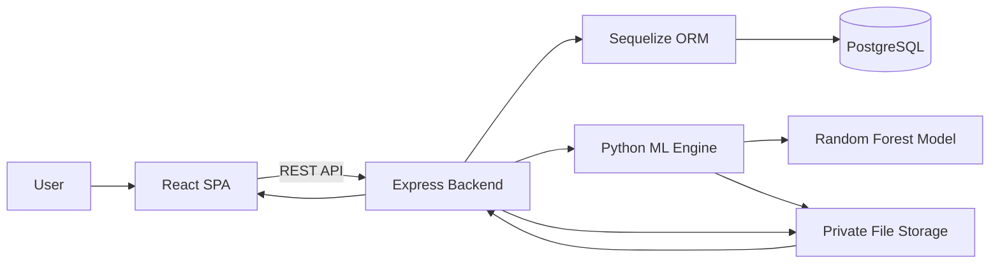

# Ocean Detective

### Web Application for Marine Debris Detection Through Multispectral Satellite Image Analysis

## Project Overview

Ocean Detective is a full-stack web application designed
for marine debris detection and semantic segmentation
of multispectral satellite imagery.

The platform combines machine learning, geospatial data
processing, interactive visualization and persistent
data management within a unified web interface.

The project investigates the effectiveness of
multispectral satellite imagery compared to conventional
RGB imagery for marine debris detection.

## Project Objectives

- Develop an interactive web platform for satellite image analysis.
- Implement machine learning-based marine debris detection.
- Compare RGB and multispectral classification approaches.
- Visualize semantic segmentation and prediction confidence.
- Provide secure user authentication and personal analysis history.
- Establish a modular and extensible application architecture.

## Main Features

- Responsive single-page application.
- User registration, authentication and account management.
- Multispectral GeoTIFF upload and validation.
- Pixel-level classification across 15 MARIDA classes.
- Interactive segmentation visualization.
- Prediction confidence visualization.
- Class distribution statistics.
- Class visibility and overlay controls.
- Personal analysis history.
- Downloadable analysis artifacts.
- RGB and multispectral model comparison.
- Light, dark and system appearance modes.

## System Architecture



The system separates presentation, business logic,
database persistence and machine learning inference.

The frontend communicates with the backend through
a REST API. The backend validates requests, manages
authentication and invokes Python scripts for
geospatial processing and machine learning inference.

## Technology Stack

| Layer | Technologies |
|---|---|
| Frontend | React, TypeScript, Vite |
| State management | Redux Toolkit |
| Routing | React Router |
| HTTP communication | Axios |
| Backend | Node.js, Express, TypeScript |
| Database | PostgreSQL |
| ORM | Sequelize |
| Authentication | JWT, HttpOnly cookies, Argon2 |
| Machine learning | Python, scikit-learn |
| Data processing | NumPy |
| Geospatial processing | Rasterio |
| Visualization | Matplotlib, CSS, Motion |
| Unit testing | Vitest, Testing Library |
| End-to-end testing | Playwright |
| Code quality | ESLint, Prettier |
| Performance and accessibility | Lighthouse, axe |
| Version control | Git, GitHub |

## Repository Structure

```text
ocean-detective/
├── frontend/
│   ├── src/
│   ├── tests/
│   └── e2e/
├── backend/
│   ├── src/
│   ├── migrations/
│   └── scripts/
├── ml/
│   ├── scripts/
│   └── models/
├── data/
├── results/
├── docs/
└── README.md
```

Large datasets, trained model binaries, environment
secrets and private user artifacts are excluded from
version control.

## Machine Learning Research

### Dataset

The project uses MARIDA (Marine Debris Archive),
a multispectral satellite imagery dataset for
marine surface classification.

The official dataset splits are preserved:

| Dataset split | Number of patches |
|---|---:|
| Training | 694 |
| Validation | 328 |
| Test | 359 |
| Total | 1381 |

Each patch contains 11 spectral bands and has a
spatial resolution of 256 x 256 pixels.

### Experimental Approach

Two multiclass Random Forest models were trained:

1. RGB model using three visible spectral bands.
2. Multispectral model using all 11 supported bands.

Both models use the same principal hyperparameters:

| Parameter | Value |
|---|---|
| Number of estimators | 100 |
| Maximum depth | 20 |
| Minimum samples per leaf | 2 |
| Class weighting | Balanced |
| Random state | 42 |

Unannotated pixels are excluded from supervised
training and evaluation.

### Marine Debris Validation Results

Marine Debris is evaluated using a one-vs-rest
interpretation of multiclass predictions.

| Metric | RGB | Multispectral |
|---|---:|---:|
| Precision | 10.12% | 80.46% |
| Recall | 12.09% | 86.98% |
| F1-score | 11.02% | 83.59% |
| IoU | 5.83% | 71.81% |

The multispectral approach improved the Marine Debris
F1-score by 72.57 percentage points.

### Multiclass Validation Results

| Metric | Result |
|---|---:|
| Overall accuracy | Approximately 92% |
| Macro F1-score | Approximately 55% |
| Weighted F1-score | Approximately 93% |
| Mean IoU | 43.62% |

Evaluation was performed on 213102 annotated,
finite validation pixels.

Detailed multiclass metrics are available in:

[Multiclass validation results](results/multiclass_rf_validation.json)

These results represent validation performance.
The official test split remains reserved for final
model evaluation.

## Getting Started

### Prerequisites

- Node.js 22.17 or a compatible newer version.
- npm.
- PostgreSQL.
- Python 3.9 or a compatible newer version.
- MARIDA dataset and trained model artifacts for ML functionality.

### Clone the Repository

```bash
git clone https://github.com/alexanerush/ocean-detective.git
cd ocean-detective
```

### Python Dependencies

```bash
python3 -m pip install -r ml/requirements.txt
```

Prepare the required MARIDA data and trained model
artifacts according to the ML documentation.

### Backend Setup

```bash
cd backend
npm ci
cp .env.example .env
```

Configure the PostgreSQL database connection,
application credentials and JWT secret.

The database and required roles must exist before
running migrations.

Apply database migrations using the migration
administrator credentials:

```bash
npm run db:migrate
npm run dev
```

Backend URL:

http://localhost:3000

Health endpoint:

http://localhost:3000/api/health

### Frontend Setup

Open a separate terminal:

```bash
cd frontend
npm ci
cp .env.example .env
npm run dev
```

Frontend URL:

http://localhost:5173

### Production Build

Frontend:

```bash
cd frontend
npm run build
```

Backend:

```bash
cd backend
npm run build
npm start
```

## Testing and Quality Assurance

The frontend includes automated unit, component,
integration and end-to-end tests.

### Latest Unit and Integration Test Results

| Test suite | Passed |
|---|---:|
| API error handling | 4/4 |
| Redux analysis state | 1/1 |
| ImageUpload | 3/3 |
| AuthForm | 1/1 |
| ImageComparison | 6/6 |
| Total | 15/15 |

All five test files passed.

Three key UI components are directly covered:
AuthForm, ImageUpload and ImageComparison.

The latest production frontend build also completed
successfully.

All 12 Playwright end-to-end tests passed after
full-stack integration in 9.9 seconds.

All 27 automated tests passed successfully.

## Security

The application implements:

- Argon2 password hashing.
- JWT-based authentication.
- HttpOnly authentication cookies.
- Authentication middleware.
- Resource ownership verification.
- Restricted CORS configuration.
- Request origin validation.
- Authentication and upload rate limiting.
- Helmet security middleware.
- Private upload and analysis storage.
- Dedicated PostgreSQL application roles.
- Environment-based configuration.

## Documentation

- [Frontend architecture and implementation](frontend/README.md)
- [Frontend quality assurance](frontend/QUALITY-README.md)
- [Backend architecture and API](backend/README.md)
- [Machine learning documentation](ml/README.md)
- [Research baseline archive](docs/research-baseline.md)

## Current Project Status

| Development area | Status |
|---|---|
| Dataset research | Implemented |
| Random Forest baseline | Implemented |
| Multispectral classification | Implemented |
| Frontend SPA | Implemented |
| REST API | Implemented |
| PostgreSQL integration | Implemented |
| Authentication | Implemented |
| User image upload | Implemented |
| ML inference integration | Implemented |
| Interactive visualization | Implemented |
| Persistent analysis history | Implemented |
| Frontend unit and component testing | 15/15 passed |
| Frontend production build | Passed |
| Final E2E verification | 12/12 passed |
| Cloud deployment | Planned |
| Final model evaluation | Planned |

## Limitations

- Input imagery must match the supported MARIDA
  spectral band order and preprocessing.
- Model performance varies across semantic classes.
- Prediction confidence is not calibrated probability.
- Pixel counts do not represent physical debris mass.
- The system does not process live satellite streams.
- Large datasets and model binaries require local preparation.
- Public cloud deployment is not yet available.

## AI Usage Disclosure

AI tools were used as supplementary resources for
technical consultation, troubleshooting, code review
and documentation support.

The author led the project development, made technical
decisions and conducted experimental evaluation.
All reported research metrics are based on actual
experiments.

## API Documentation

The REST API is documented using OpenAPI 3.0.3.

- [OpenAPI specification](backend/docs/openapi.yaml)
- [Getting Started Guide](backend/docs/GETTING-STARTED.md)
- [Integration Tutorial](backend/docs/INTEGRATION-TUTORIAL.md)

Interactive documentation is available after starting
the backend:

- Swagger UI: http://localhost:3000/api/docs/
- OpenAPI JSON: http://localhost:3000/api/openapi.json

Validate the API specification:

    cd backend
    npm run docs:validate

## Adaptive UI and Design System

Ocean Detective provides a responsive interface designed for desktop,
tablet and mobile devices, with consistent visual styling and accessible
interaction patterns.

### Responsive Interface

- Responsive layouts for desktop, tablet and mobile devices.
- Portrait and landscape layout support.
- Adaptive navigation and flexible content grids.
- Light, dark and system theme preferences.
- Adjustable interface text scale: 100%, 112.5% and 125%.
- Minimum 44 px interaction targets for primary controls.
- Visible keyboard focus indicators.
- Reduced-motion preference support.
- Accessible form labels and validation feedback.
- Horizontally scrollable containers for wide scientific tables.
- Manual browser zoom verification at 200%.

### Design System and Mockups

The interface uses shared CSS design tokens and reusable React components
for consistent colors, typography, spacing, controls and feedback states.

Six editable SVG dashboard mockups cover three device sizes in both
light and dark themes. A separate visual UI kit documents the shared
design language and component states.

- [Design System Documentation](docs/adaptive-ui/DESIGN-SYSTEM.md)
- [Figma Design File](https://www.figma.com/design/jFATdDOXIBd4FkuB5qYCY5/Ocean-Detective-Adaptive-UI?node-id=0-1)
- [Editable SVG Mockups](docs/adaptive-ui/mockups/)
- [Visual UI Kit](docs/adaptive-ui/mockups/ui-kit.svg)

Functional reusable components are implemented in React.
The Figma file contains visual component examples rather than native
Figma component variants.

### Interface Screenshots

The repository contains 52 screenshots documenting responsive layouts,
theme variations, authenticated workflows and browser zoom behavior.

| Category | Screenshots |
| --- | ---: |
| Public pages — light theme | 15 |
| Public pages — dark theme | 15 |
| Authenticated pages — both themes | 18 |
| Manual browser zoom verification | 4 |
| Total | 52 |

Public screenshots cover Dashboard, Satellite Analysis, ML Experiments,
Sign In and Create Account.

Authenticated screenshots cover Account, Analysis History and real
ML analysis results using a dedicated demonstration account.

- [Light Theme Screenshots](docs/adaptive-ui/screenshots/)
- [Dark Theme Screenshots](docs/adaptive-ui/screenshots/dark/)
- [Authenticated Screenshots](docs/adaptive-ui/screenshots/authenticated/)
- [200% Browser Zoom Evidence](docs/adaptive-ui/screenshots/zoom-200/)

### Responsive Quality Assurance

The adaptive UI milestone was verified using Vitest and Playwright.

| Verification | Result |
| --- | ---: |
| Unit and integration tests | 15 passed |
| End-to-end tests | 62 passed |
| Intentionally skipped duplicate scenarios | 10 |
| Total passed tests | 77 |

Responsive checks cover multiple viewport sizes, navigation,
touch-target dimensions and selected color contrast requirements.

Manual browser zoom verification was performed at 200% on Dashboard,
Satellite Analysis and ML Experiments.

The accessibility implementation follows selected WCAG 2.1 AA
requirements. These checks do not constitute a complete WCAG
conformance audit.

### Reproducing the Visual Documentation

With the frontend and backend running locally:

```bash
cd frontend

npm run build
npm test
npm run test:e2e

node scripts/capture-adaptive.mjs
node scripts/capture-adaptive-dark.mjs
node scripts/capture-authenticated.mjs

python3 scripts/generate-mockups.py
```

Authenticated screenshot generation requires a configured database,
the local MARIDA sample and the trained multispectral model.
It creates a demonstration account, uploads a GeoTIFF and runs real
ML inference. Generated credentials and session data are not written
to the repository.

The 200% browser zoom screenshots were captured manually.
