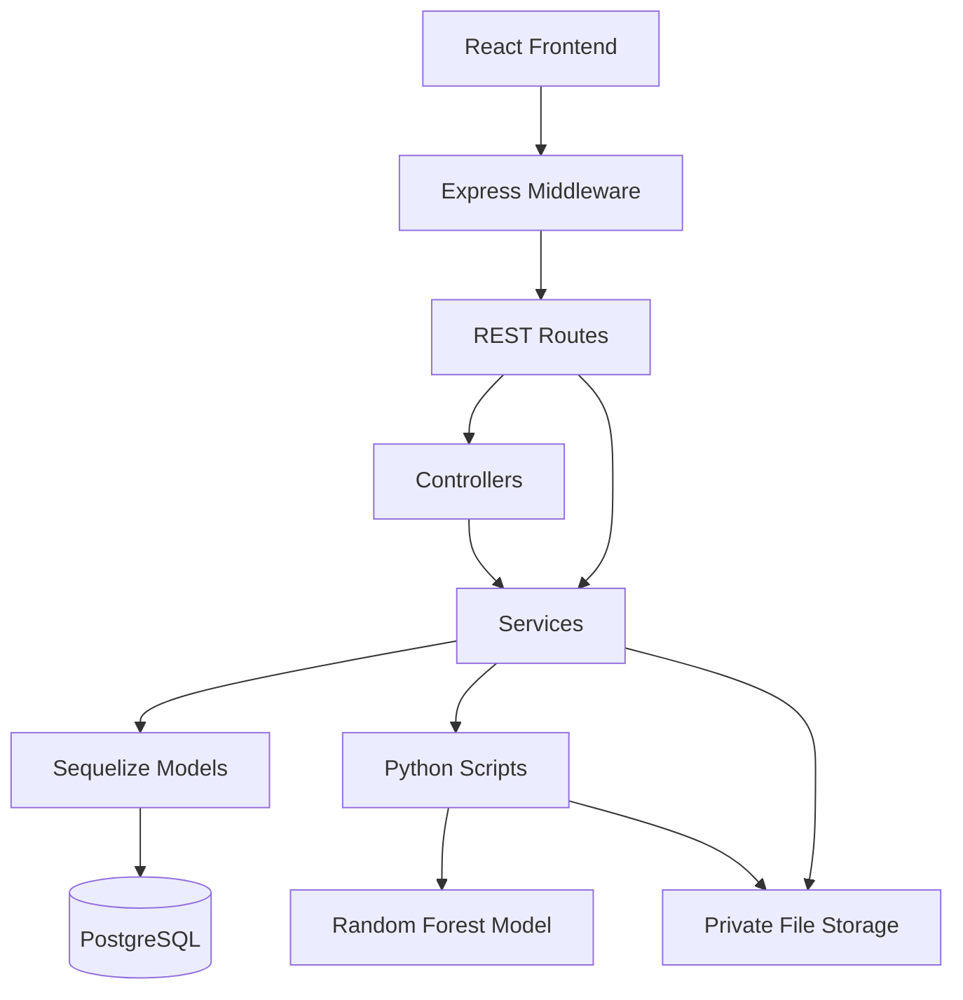
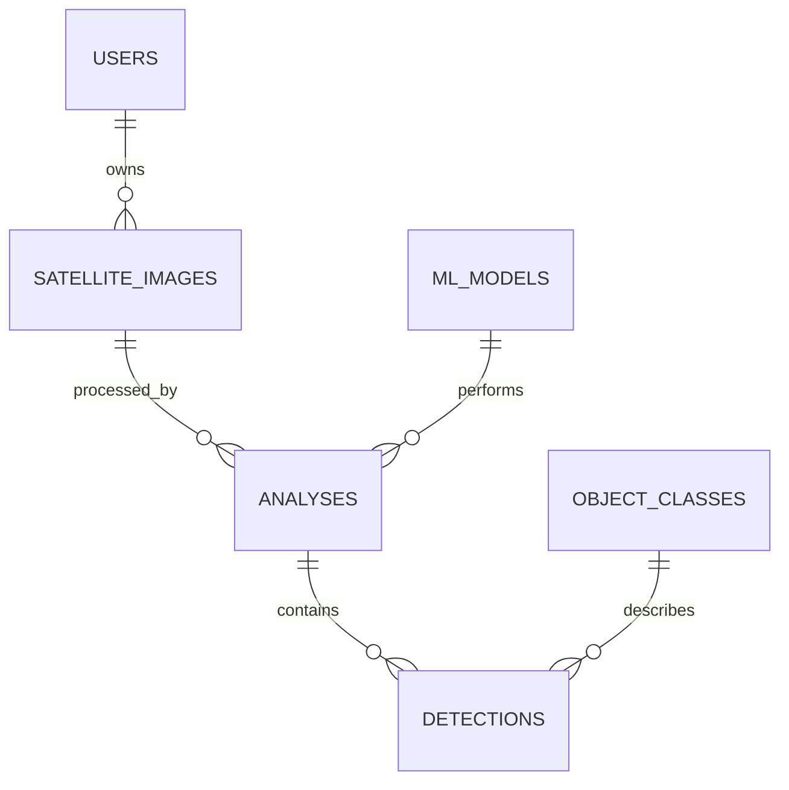
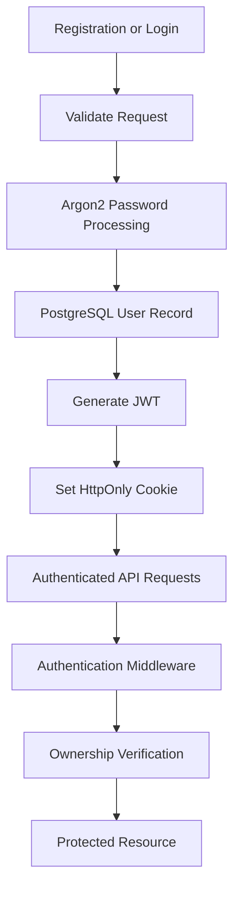

# Ocean Detective — Backend

## Overview

The Ocean Detective backend provides REST API
services, authentication, PostgreSQL persistence,
satellite image validation and machine learning
integration.

It connects the frontend application with the
database, private file storage and Python-based
geospatial processing and inference scripts.

## Technology Stack

| Technology | Purpose |
|---|---|
| Node.js | Server runtime |
| Express | REST API framework |
| TypeScript | Static typing |
| PostgreSQL | Relational database |
| Sequelize | Object-relational mapping |
| Argon2 | Password hashing |
| JSON Web Tokens | Authentication |
| Cookie Parser | Authentication cookie processing |
| Multer | Multipart file uploads |
| Helmet | HTTP security headers |
| Express Rate Limit | Request rate limiting |
| Python | Geospatial processing and ML inference |

## Backend Architecture



The backend separates HTTP routing, middleware,
business logic, database access and machine
learning integration.

## Source Structure

```text
backend/
├── migrations/
│   ├── 001_schema.sql
│   ├── 002_features.sql
│   ├── 003_permissions.sql
│   └── 004_rf_catalog.sql
├── scripts/
├── src/
│   ├── config/
│   ├── controllers/
│   ├── db/
│   ├── middleware/
│   ├── routes/
│   ├── services/
│   ├── app.ts
│   └── server.ts
├── .env.example
├── package.json
└── tsconfig.json
```

## Database Architecture

The PostgreSQL database contains six principal
domain tables.

| Table | Responsibility |
|---|---|
| users | User accounts and authentication metadata |
| satellite_images | Uploaded satellite image metadata |
| ml_models | Machine learning model catalog |
| analyses | Analysis execution and result metadata |
| object_classes | Semantic classification catalog |
| detections | Per-class detection statistics |

### Entity Relationship Diagram



The diagram represents principal domain relationships.

Large binary files are stored outside the database.
Database records retain associated metadata and
references.

Detection statistics represent classified pixels
rather than individual physical debris objects.

## Database Roles

The database uses dedicated roles to separate
administrative and application responsibilities.

| Role | Responsibility |
|---|---|
| ocean_admin | Schema administration and migrations |
| ocean_app | Application database operations |
| ocean_read | Restricted read-only access |

The application does not require PostgreSQL
superuser privileges during normal operation.

## REST API

### Public Research Endpoints

| Method | Endpoint | Description |
|---|---|---|
| GET | /api/health | Service and database health |
| POST | /api/analyze | Inspect configured MARIDA sample |
| GET | /api/model-comparison | Retrieve research comparison results |

### Authentication Endpoints

| Method | Endpoint | Description |
|---|---|---|
| POST | /api/auth/register | Register a user |
| POST | /api/auth/login | Authenticate a user |
| POST | /api/auth/logout | Clear authentication cookie |
| GET | /api/auth/me | Retrieve authenticated user |

Authentication uses JWT tokens stored in HttpOnly
cookies.

Passwords are hashed using Argon2.

### Upload Endpoints

| Method | Endpoint | Description |
|---|---|---|
| POST | /api/uploads | Upload a satellite image |
| GET | /api/uploads?page=0 | Retrieve paginated user uploads |

Upload requests require authentication.

The upload endpoint accepts multipart/form-data
with a single file field named image.

Maximum upload size: 25 MiB.

Uploaded files are validated before being registered
in the database.

### Analysis Endpoints

| Method | Endpoint | Description |
|---|---|---|
| POST | /api/analyses | Execute ML inference |
| GET | /api/analyses | Retrieve owned analyses |
| GET | /api/analyses/:id | Retrieve analysis details |
| GET | /api/analyses/:id/files/:name | Retrieve analysis artifact |

Example analysis request:

```json
{
  "imageId": "<uploaded-image-id>",
  "confirmed": true
}
```

The confirmed field indicates explicit confirmation
of MARIDA spectral compatibility.

Analysis records and generated artifacts are
restricted to authorized resource owners.

## Authentication Workflow



Authentication cookies have a one-hour lifetime.

Logout clears the authentication cookie.

## Satellite Image Processing

The upload and analysis workflow includes:

1. User authentication.
2. Multipart file upload.
3. File size validation.
4. Private file storage.
5. GeoTIFF structure validation.
6. Spectral band validation.
7. Satellite image metadata persistence.
8. User confirmation of spectral compatibility.
9. Python-based multiclass inference.
10. Analysis result persistence.
11. Private artifact retrieval.

### Processing Constraints

| Constraint | Value |
|---|---|
| Maximum uploaded file size | 25 MiB |
| Maximum image dimensions | 1024 x 1024 |
| Required spectral bands | 11 |
| Maximum decoded image size | 128 MiB |
| Inference window size | 256 x 256 |
| Analysis execution timeout | 60 seconds |

The application requires MARIDA-compatible band
ordering and preprocessing.

## Machine Learning Integration

The backend invokes Python scripts for:

- GeoTIFF validation.
- Configured MARIDA sample inspection.
- Multiclass Random Forest inference.
- Segmentation artifact generation.
- Prediction confidence calculation.
- Per-class pixel statistics.

The trained multispectral model must be available
in the local ml/models directory.

Machine learning model binaries and large datasets
are excluded from Git.

## Security

Implemented security mechanisms include:

- Argon2 password hashing.
- JWT-based authentication.
- HttpOnly authentication cookies.
- Authentication middleware.
- Resource ownership verification.
- Restricted CORS configuration.
- Request origin validation.
- Authentication rate limiting.
- Upload rate limiting.
- Helmet security headers.
- File size restrictions.
- Private upload and analysis storage.
- Unique uploaded file names.
- Centralized error handling.
- Dedicated database roles.
- Environment-based secret management.

These mechanisms provide application-level
security controls but do not constitute a
complete independent security audit.

## Installation

### Prerequisites

- Node.js 22.17 or a compatible newer version.
- PostgreSQL.
- Python and required ML dependencies.
- Trained Random Forest model artifacts.

Install Node.js dependencies:

```bash
npm ci
```

Create the local environment configuration:

```bash
cp .env.example .env
```

### Environment Variables

```dotenv
PORT=3000
DB_HOST=127.0.0.1
DB_PORT=5433
DB_NAME=ocean_detective
DB_USER=ocean_app
DB_PASSWORD=
CORS_ORIGIN=http://localhost:5173
PYTHON_BIN=python3
JWT_SECRET=
```

Configure the database password and JWT secret
before starting the application.

Generate a development JWT secret using:

```bash
openssl rand -hex 32
```

Store the generated value in the local .env file.

Never commit real database passwords or JWT secrets.

### Database Migrations

Create the PostgreSQL database and required roles
before applying migrations.

The migration script requires administrator
credentials through the local environment.

For zsh:

```bash
read -s "MIGRATION_PASSWORD?Ocean admin password: "
export MIGRATION_PASSWORD
npm run db:migrate
unset MIGRATION_PASSWORD
```

The migration files establish the database schema,
application features, permissions and model catalog.

### Development Server

```bash
npm run dev
```

Default server URL:

http://localhost:3000

### Health Check

```bash
curl http://localhost:3000/api/health
```

Expected response when the database is available:

```json
{
  "status": "ok",
  "service": "ocean-detective-backend",
  "database": "connected"
}
```

### Production Build

```bash
npm run build
npm start
```

## Available Commands

| Command | Purpose |
|---|---|
| npm run dev | Development server |
| npm run build | TypeScript compilation |
| npm start | Start compiled backend |
| npm run db:migrate | Apply database migrations |

## Development Status

The following functionality has been implemented
and exercised in the local development environment:

- REST API communication.
- PostgreSQL connectivity.
- Database migrations.
- User registration and authentication.
- Session restoration.
- Satellite image upload.
- GeoTIFF validation.
- Multiclass ML inference.
- Persistent analysis history.
- Private artifact retrieval.

Formal OpenAPI documentation, comprehensive
automated backend testing, production monitoring
and cloud deployment remain subsequent
development tasks.

## API Documentation

The API specification follows the OpenAPI 3.0.3
industry standard.

### Developer Resources

| Resource | Location |
|---|---|
| OpenAPI specification | [openapi.yaml](docs/openapi.yaml) |
| Getting Started | [Getting Started Guide](docs/GETTING-STARTED.md) |
| Integration tutorial | [Integration Tutorial](docs/INTEGRATION-TUTORIAL.md) |
| Swagger UI | http://localhost:3000/api/docs/ |
| OpenAPI JSON | http://localhost:3000/api/openapi.json |

### Specification Validation

    npm run docs:validate

### Interactive Documentation

    npm run dev

Open http://localhost:3000/api/docs/ in a browser.

The specification documents authentication,
request parameters, request bodies, response models,
HTTP status codes, error messages and examples.

### Requirements Traceability

| Requirement | Implementation |
|---|---|
| Industry-standard API specification | OpenAPI 3.0.3 |
| Version-controlled YAML specification | docs/openapi.yaml |
| Automated specification validation | scripts/validate-openapi.cjs |
| Endpoint documentation and examples | docs/openapi.yaml |
| Reusable data models | OpenAPI components/schemas |
| Getting Started Guide | docs/GETTING-STARTED.md |
| Step-by-step integration tutorial | docs/INTEGRATION-TUTORIAL.md |
| Developer-accessible documentation | Swagger UI and Markdown |
