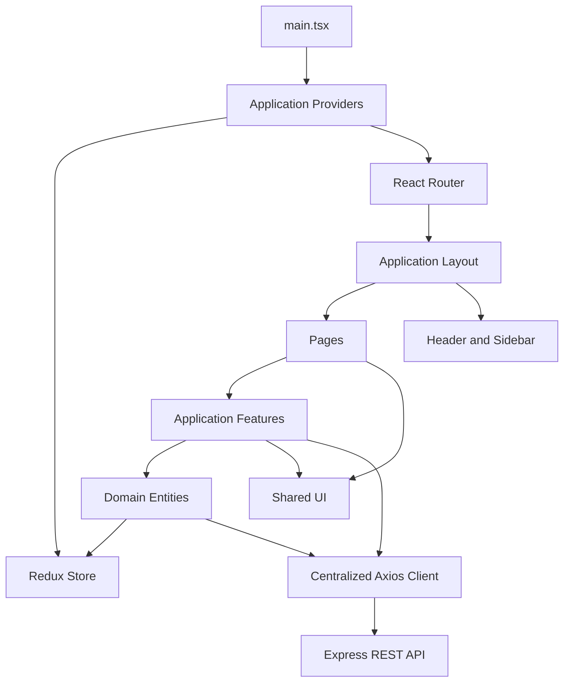
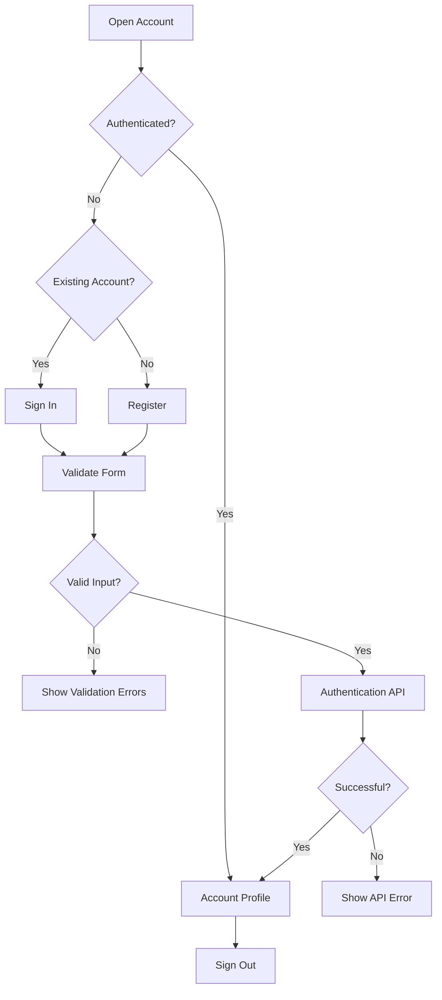
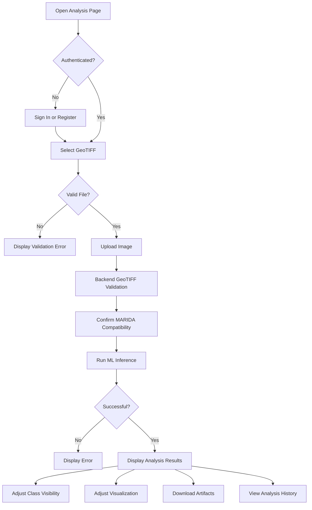
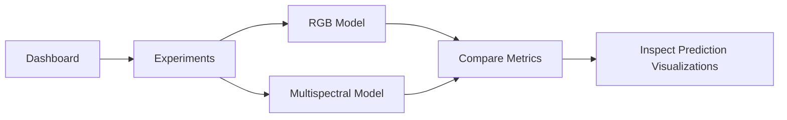
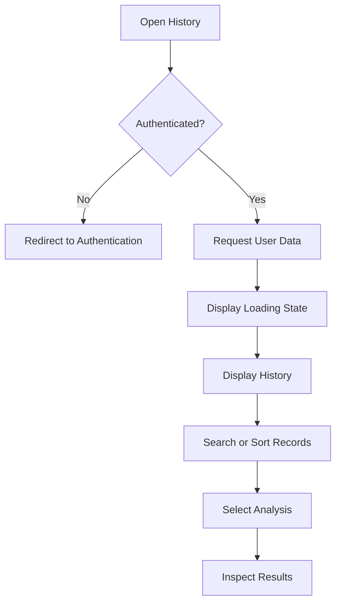

# Ocean Detective — Frontend

## Overview

The Ocean Detective frontend is a responsive
single-page application for multispectral satellite
image analysis, marine debris detection and
interactive machine learning visualization.

The application provides a unified interface for
authentication, satellite image uploads, research
exploration, semantic segmentation visualization
and personal analysis history.

## Technology Stack and Justification

| Technology | Purpose and justification |
|---|---|
| React | Declarative rendering and reusable UI components |
| TypeScript | Static typing and safer application development |
| Vite | Fast development and optimized production builds |
| Redux Toolkit | Predictable global state management |
| React Router | Client-side routing and protected routes |
| Axios | Centralized HTTP communication and error handling |
| Motion | Interactive animations and visualization transitions |
| CSS | Responsive layouts and reusable design tokens |
| Vitest | Fast unit and integration testing |
| Testing Library | User-oriented component testing |
| Playwright | Automated browser and end-to-end testing |
| ESLint | Static code quality analysis |
| Prettier | Consistent source formatting |
| Lighthouse | Performance and accessibility analysis |
| axe | Automated accessibility testing |

React was selected because of its component-based
architecture and suitability for interactive
data-driven applications.

TypeScript improves maintainability by providing
typed component properties, application state
and API contracts.

Vite provides a lightweight development environment,
fast module transformation and production code splitting.

Redux Toolkit centralizes shared application state,
while local component state manages temporary
interaction and presentation settings.

## Frontend Architecture

The application follows a Feature-Sliced
Design-inspired architecture.

Responsibilities are separated into application
configuration, pages, widgets, features, domain
entities and shared infrastructure.



## Source Structure

```text
frontend/
├── src/
│   ├── app/
│   │   ├── layouts/
│   │   ├── providers/store/
│   │   ├── router/
│   │   └── styles/
│   ├── pages/
│   │   ├── account/
│   │   ├── analysis/
│   │   ├── dashboard/
│   │   ├── experiments/
│   │   ├── history/
│   │   └── not-found/
│   ├── widgets/
│   │   ├── header/
│   │   └── sidebar/
│   ├── features/
│   │   ├── auth/
│   │   ├── display-settings/
│   │   ├── image-upload/
│   │   ├── ml-results/
│   │   └── user-upload/
│   ├── entities/
│   │   ├── analysis/
│   │   ├── ml-model/
│   │   └── user/
│   ├── shared/
│   │   ├── api/
│   │   ├── config/
│   │   └── ui/
│   ├── main.tsx
│   └── style.css
├── tests/
├── e2e/
├── scripts/
├── vite.config.ts
├── vitest.config.ts
├── playwright.config.ts
└── package.json
```

### Architecture Layers

| Layer | Responsibility |
|---|---|
| app | Application initialization, providers and routing |
| pages | Route-level application screens |
| widgets | Composite layout and navigation components |
| features | User interactions and application workflows |
| entities | Domain models, state and API operations |
| shared | Reusable UI, configuration and infrastructure |

## Application Routes

| Route | Purpose | Access |
|---|---|---|
| / | Dashboard | Public |
| /analysis | Satellite image analysis | Public page |
| /experiments | ML research and comparison | Public |
| /history | Personal analysis history | Authenticated |
| /account | Redirect to account interface | Public |
| /login | Sign in and account profile | Public |
| /register | Registration | Public |
| * | Not Found page | Public |

Personal uploads, ML inference and private analysis
artifacts require backend authentication.

Route configuration is implemented in:

src/app/router/AppRouter.tsx

All primary page components use lazy loading.

## User Flows

### User Authentication



### Satellite Image Analysis



### Research Exploration



### Personal Analysis History



## Component-Based Development

The application is composed of reusable components
with clearly separated responsibilities.

| Component | Responsibility |
|---|---|
| AuthForm | Authentication and registration forms |
| RequireAuth | Protected route access |
| SessionProvider | Authentication session restoration |
| ImageUpload | File selection and validation |
| UserUpload | Authenticated satellite image upload |
| RunAnalysis | Machine learning analysis workflow |
| Results | Analysis result presentation |
| ImageComparison | Interactive image overlay comparison |
| BarChart | Statistical data visualization |
| ResultImage | Result image presentation |
| ErrorBoundary | React rendering error handling |
| Toast | Application notifications |
| DisplaySettings | Appearance configuration |
| Header | Application header |
| Sidebar | Responsive navigation |

Reusable UI components are located in src/shared/ui.

## State Management

Redux Toolkit manages shared application state,
including:

- Authentication state.
- User session information.
- Analysis request state.
- Analysis results.
- Analysis history.
- Loading and error states.

Relevant implementation:

- src/app/providers/store/store.ts
- src/entities/user/authSlice.ts
- src/entities/analysis/model/analysisSlice.ts
- src/entities/analysis/model/historySlice.ts
- src/entities/analysis/model/selectors.ts

Local React state manages temporary interface state,
including form values, file selection, image
comparison position and visualization controls.

Appearance preferences are persisted locally.

## REST API Integration

HTTP communication is centralized through Axios.

Relevant implementation:

- src/shared/api/apiClient.ts
- src/shared/api/apiError.ts
- src/shared/api/resultsUrl.ts
- src/shared/config/env.ts

Domain-specific API operations are located in:

- src/entities/analysis/api.ts
- src/entities/ml-model/api.ts

The centralized client provides configurable API
URLs, request timeouts, credential handling and
normalized error responses.

### API Operations

| Method | Endpoint | Purpose |
|---|---|---|
| GET | /api/health | Backend health |
| POST | /api/auth/register | User registration |
| POST | /api/auth/login | Authentication |
| POST | /api/auth/logout | Sign out |
| GET | /api/auth/me | Session restoration |
| POST | /api/analyze | Configured MARIDA sample inspection |
| GET | /api/model-comparison | Research results |
| POST | /api/uploads | GeoTIFF upload |
| GET | /api/uploads | Paginated user uploads |
| POST | /api/analyses | Multiclass inference |
| GET | /api/analyses | User analyses |
| GET | /api/analyses/:id | Analysis details |
| GET | /api/analyses/:id/files/:name | Analysis artifacts |

The public research workflow is separated from
authenticated user-provided image inference.

## Forms and Validation

Authentication forms provide:

- Controlled input fields.
- Email format validation.
- Password validation.
- Password confirmation validation.
- Validation feedback.
- Submission loading states.
- API error feedback.

Image upload validation includes:

- Required file selection.
- TIFF and GeoTIFF extension validation.
- Non-empty file validation.
- Maximum file size of 25 MiB.

The backend performs additional file structure,
spectral compatibility and geospatial validation.

Client-side validation improves usability but does
not replace backend security validation.

## Global Error Handling

The application provides centralized error handling
through:

- Axios error normalization.
- React Error Boundary.
- Toast notifications.
- Form-level validation messages.
- Loading and skeleton components.
- Retry mechanisms where applicable.
- Dedicated Not Found page.

Supported HTTP error handling includes authentication,
authorization, missing resources, invalid requests,
file size limitations, rate limiting and server errors.

Relevant implementation:

- src/shared/api/apiError.ts
- src/shared/api/apiClient.ts
- src/shared/ui/ErrorBoundary.tsx
- src/shared/ui/Toast.tsx
- src/shared/ui/controls.tsx

## Loading States

Asynchronous workflows expose loading, success and
failure states.

Loading indicators and skeleton components provide
feedback during API communication, session
restoration and data retrieval.

Long-running ML inference requests use a configurable
HTTP timeout.

## Responsive Design

The interface supports desktop, tablet and mobile
screen sizes.

Responsive implementation includes:

- Adaptive navigation.
- Responsive content grids.
- Flexible image visualization.
- Mobile-compatible controls.
- Reusable CSS design tokens.
- Light, dark and system themes.
- Display scaling options.
- Keyboard focus indicators.
- Reduced-motion support.

Relevant implementation:

- src/app/styles/design-system.css
- src/app/layouts/
- src/widgets/sidebar/
- src/features/display-settings/

## Interactive Data Visualization

The analysis interface provides:

- RGB satellite imagery.
- Semantic segmentation masks.
- Prediction confidence visualization.
- Class distribution statistics.
- Class visibility controls.
- Overlay opacity controls.
- Interactive image comparison.
- Downloadable analysis artifacts.

The experiments page presents research metrics
and qualitative model comparison visualizations.

The personal history interface supports data
retrieval, searching and sorting of loaded records.

## Performance Optimization

The application uses:

- Route-level lazy loading.
- Production code splitting.
- Reusable UI components.
- Centralized state management.
- Optimized Vite production builds.
- Configurable HTTP timeouts.
- Request cancellation where applicable.

### Latest Production Build

| Metric | Result |
|---|---:|
| TypeScript compilation | Passed |
| Vite production build | Passed |
| Transformed modules | 567 |
| Build time | 326 ms |
| Main JavaScript bundle | 324.65 kB |
| Main JavaScript bundle gzip | 106.11 kB |
| Analysis page bundle gzip | 48.90 kB |

Build measurements are specific to the local
development environment.

## Automated Testing

The project uses Vitest and Testing Library
for unit, integration and component testing.

Playwright provides automated browser testing.

### Unit and Component Test Coverage

| Test file | Tested functionality | Passed |
|---|---|---:|
| apiError.test.ts | API error normalization | 4/4 |
| analysis.test.ts | Redux analysis state | 1/1 |
| upload.test.tsx | ImageUpload validation | 3/3 |
| auth.test.tsx | AuthForm registration validation | 1/1 |
| imageComparison.test.tsx | ImageComparison interaction and errors | 6/6 |
| Total | | 15/15 |

### Key Component Tests

#### AuthForm

- Registration input validation.
- Prevention of invalid server requests.

#### ImageUpload

- File input validation.
- Invalid file handling.
- Upload size restrictions.

#### ImageComparison

- Rendering both satellite images.
- Accessible image descriptions.
- Default overlay coverage.
- Slider interaction.
- Minimum and maximum coverage.
- Original image loading failure.
- Overlay image loading failure.

### Latest Test Execution

```text
Test Files  5 passed (5)
Tests       15 passed (15)
Duration    4.06s
```

All unit and integration tests passed after the
latest full-stack integration.

### End-to-End Testing

Browser tests are implemented in:

e2e/ui.spec.ts

The suite covers:

- Application navigation.
- Responsive layouts.
- File validation.
- Appearance preference persistence.
- Dashboard accessibility.

The latest end-to-end verification completed all
12 Playwright tests successfully across desktop,
tablet and mobile configurations.

Execution time: 9.9 seconds.

All 27 automated tests passed after full-stack
integration.

## Accessibility

Accessibility considerations include:

- Semantic HTML.
- Accessible form labels.
- Alternative image descriptions.
- Keyboard-accessible controls.
- Visible focus indicators.
- Reduced-motion support.
- Automated axe checks.

Previous automated dashboard accessibility checks
were performed in both light and dark themes.

Complete application-wide WCAG compliance has
not yet been established.

## Installation and Development

```bash
npm ci
cp .env.example .env
npm run dev
```

Development URL:

http://localhost:5173

The backend must be running for authentication,
uploads, ML inference and persistent history.

### Environment Configuration

```dotenv
VITE_API_URL=http://localhost:3000/api
VITE_API_TIMEOUT=90000
```

## Available Commands

| Command | Purpose |
|---|---|
| npm run dev | Development server |
| npm run build | TypeScript and production build |
| npm run preview | Preview production build |
| npm test | Unit and integration tests |
| npm run test:coverage | Coverage report |
| npm run test:e2e | Playwright browser tests |
| npm run lint | ESLint checks |
| npm run format | Format source files |
| npm run format:check | Verify formatting |
| npm run bundle:report | Bundle size report |
| npm run lighthouse | Lighthouse analysis |

Install Playwright browsers before running
end-to-end tests:

```bash
npx playwright install
```

Additional quality assurance instructions are
available in [QUALITY-README.md](QUALITY-README.md).

## Frontend Requirements Traceability

| Requirement | Implementation | Status |
|---|---|---|
| Modern SPA framework | React | Implemented |
| Modern bundler | Vite | Implemented |
| Architecture diagram | Frontend Architecture | Documented |
| User flow diagrams | User Flows | Documented |
| Technology justification | Technology Stack | Documented |
| Component-based architecture | pages, widgets, features, shared | Implemented |
| API services | shared/api, entities | Implemented |
| Form validation | AuthForm, ImageUpload | Implemented |
| Global error handling | Axios, ErrorBoundary, Toast | Implemented |
| Loading states | Async state and shared controls | Implemented |
| Three key component tests | AuthForm, ImageUpload, ImageComparison | Passed |
| Unit and integration testing | tests/ | 15/15 passed |
| End-to-end testing | e2e/ui.spec.ts | 12/12 passed |
| Client-side routing | AppRouter.tsx | Implemented |
| Global state management | Redux Toolkit | Implemented |
| Local state management | React hooks | Implemented |
| Protected routes | RequireAuth | Implemented |
| Responsive design | Layouts and CSS | Implemented |
| Search and sorting | History interface | Implemented |
| Code splitting | Lazy-loaded routes | Implemented |
| Code quality tooling | ESLint, Prettier | Configured |
| Performance analysis | Lighthouse, bundle report | Configured |
| Accessibility testing | axe, Playwright | Implemented |
| Production build | TypeScript and Vite | Passed |

## Deployment Status

The frontend is operational locally and integrated
with the backend, PostgreSQL and Python ML engine.

A public production deployment is planned for
a subsequent development stage.
